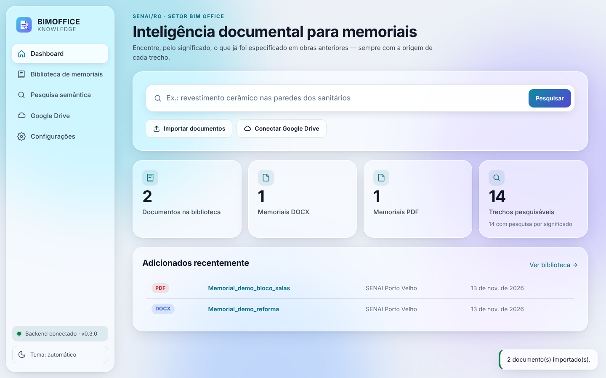

# BIMOFFICE Knowledge

Biblioteca inteligente de memoriais descritivos (SENAI) com pesquisa semântica local.
Status: **v0.3** — biblioteca DOCX **e PDF**, pesquisa híbrida (E5 + FTS5) e **interface web Liquid Glass**.



Interface publicada (após ativar o GitHub Pages): https://brunno100barros-del.github.io/BIMOFFICE-Knowledge/
— sem backend ela abre em **modo demonstração**; veja [docs/PUBLICACAO.md](docs/PUBLICACAO.md).

## Como executar (Windows)
1. Instale o Python **3.13** (python.org) marcando "Add python.exe to PATH".
   Use 3.11, 3.12 ou 3.13: versões mais novas (3.14, 3.15) ainda não têm o PyTorch,
   usado pela pesquisa semântica. O `iniciar.bat` escolhe sozinho uma versão compatível.
2. Dê dois cliques em `iniciar.bat`.
3. Abra **http://127.0.0.1:8000/** — a interface do programa.
   (A documentação técnica da API continua em http://127.0.0.1:8000/docs.)

Linux/macOS: `./iniciar.sh`

## Testes
```
python -m pytest -q
```

## Etapa 1 — o que existe
- Importação de DOCX (validação, hash SHA-256, detecção de duplicados, original somente leitura)
- Detecção de seções (estilos "Título N" + heurística de numeração/caixa alta), tabelas
- Divisão em trechos respeitando seções
- SQLite + FTS5 (busca por palavras, ignora acentos)
- Filtros, edição de metadados, exclusão lógica (lixeira) + restauração, reindexação, backup

## Interface (v0.3)
- Menu lateral: Dashboard, Biblioteca de memoriais, Pesquisa semântica, Google Drive, Configurações.
- Importação de **vários DOCX/PDF de uma vez**, com barra de progresso e erro individual por arquivo.
- Biblioteca em cartões ou lista, filtros (tipo, unidade, disciplina), abrir, baixar original,
  excluir (lixeira) e restaurar. Visualização das seções e trechos de cada documento.
- Pesquisa com relevância relativa, origem completa, destaque dos termos e
  "Copiar com origem" (o texto vai com a referência do documento/seção).
- Tema claro/escuro/automático (fica salvo). Funciona no celular.
- Configurações: endereço do backend, senha da API, estado do modelo, reindexação e backup.


## PDF (v0.3)
- Lido com **pypdf** (licença BSD). Títulos detectados por numeração/CAIXA ALTA; cabeçalhos e
  rodapés repetidos e números de página são removidos; a **página é real** (no DOCX é estimada).
- Entra na **mesma** pesquisa híbrida dos DOCX (mesmo chunker, mesmo modelo E5).
- PDF escaneado (sem texto) é recusado com aviso. **Não há OCR** nesta versão
  (ponto de extensão `OcrProvider` em `backend/document_processing/pdf_parser.py`).

## Etapa 2 — pesquisa inteligente
- Modelo local `intfloat/multilingual-e5-base` (prefixos "query:"/"passage:"), roda no próprio
  computador; nenhum texto de documento sai da máquina. Baixado uma vez (~1 GB).
- Vetores gravados no SQLite; busca vetorial com numpy; fusão com a busca por palavras (RRF).
- Rotas: `GET /api/search?q=...&unit=&discipline=&project=&mode=hybrid|semantic|text`,
  `GET /api/search/status`, `POST /api/search/reindex` (gera vetores pendentes; `force=true` refaz todos).
- **Relevância relativa** (0–100): 100 = 1º lugar nas duas buscas; achado por uma só ≤ ~50.
  Não é probabilidade nem equivalência técnica — sempre revise o trecho.
- Sem o modelo instalado, a pesquisa avisa e usa só a busca por palavras (nada é simulado).
- Conferir seus memoriais: coloque DOCX em `amostras/` e rode
  `python scripts/inspecionar_amostras.py` (seções/trechos) e
  `python scripts/avaliar_pesquisa.py "sua pergunta"` (resultados da pesquisa).

## Limitações conhecidas
- Numeração automática do Word não é lida; cabeçalhos/rodapés/caixas de texto não são indexados.
- Página do trecho é apenas ESTIMADA (o DOCX não guarda paginação).
- Ainda não existem: Google Drive, backend online, editor do memorial em elaboração e exportação DOCX.
- Busca por palavras não reconhece plural/singular ("elétrico" ≠ "elétricos"); a semântica cobre.
- Qualidade medida em 10 paráfrases técnicas sem palavras em comum: 8/10 em 1º lugar, todas no
  top 3 (só a parte semântica). Ainda NÃO medida com memoriais reais.
- Busca vetorial carrega os vetores a cada pesquisa: ok para milhares de trechos; para dezenas de
  milhares, trocar a camada por FAISS/Qdrant.
- O PyTorch ocupa ~1 GB no `.venv`; a 1ª pesquisa após ligar o servidor demora alguns segundos.

- PDF: tabelas viram texto corrido; títulos e parágrafos são reconstruídos por heurística.
- Destaque de termos na pesquisa marca prefixos ("forro" em "Forros").

## Publicação e arquitetura online
Veja [docs/PUBLICACAO.md](docs/PUBLICACAO.md): GitHub Pages (interface), backend separado,
variáveis de ambiente, senha da API, CORS e o plano do Google Drive.

## Privacidade
`data/` (documentos, banco, backups) está no `.gitignore`: documentos da instituição não vão ao GitHub.
